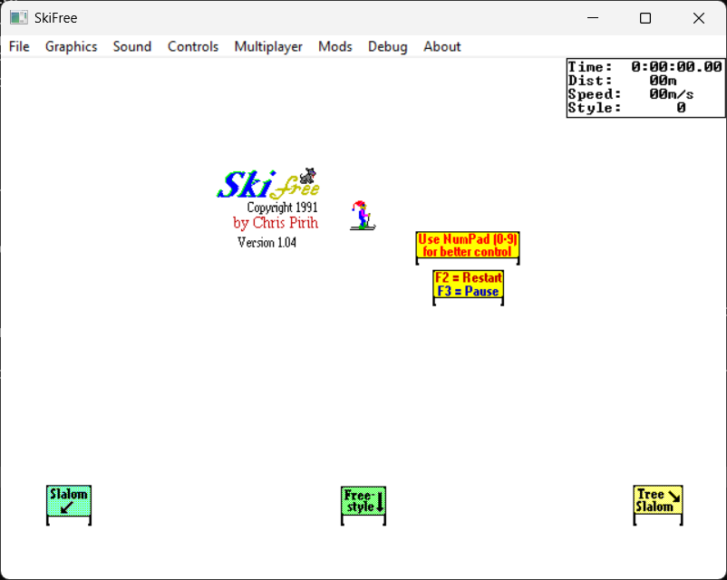

# SkiFree: Reborn

**The yeti is back. And this time, he compiles on everything.**



This is a static recompilation of [SkiFree](https://ski.ihoc.net/) — the legendary 1991 Windows game by Chris Pirih that traumatized an entire generation of computer users. You know the one. You're just skiing along, minding your own business, doing some sick jumps, dodging trees... and then *he* shows up.

This project takes the original `ski32.exe` binary — every function, every sprite, every pixel of that terrifying yeti — and rebuilds it from decompiled C source code to run natively on modern operating systems with a ton of new features on top.

## A Love Letter

SkiFree wasn't just a game. It was a rite of passage. It shipped with the Microsoft Entertainment Pack 3 in 1991, and for millions of kids in the '90s, it was the first video game they ever played. It lived on every school computer, every office PC, every family desktop wedged between Minesweeper and Solitaire.

And it was *perfect*. The controls were dead simple. The pixel art was charming. The physics felt right. And the abominable snowman? The abominable snowman was the first horror game boss fight most of us ever experienced, hiding in plain sight inside an innocent little ski game.

Did you know you can outrun him by pressing **F** for turbo mode? Most people didn't. Most people just... got eaten. Over and over. And kept coming back.

That's the magic of SkiFree.

## Features

### Original Game (fully preserved)
- All original sprites, physics, and game logic from ski32.exe
- Three hidden timed courses: Slalom (SS), Freestyle (FS), Giant Slalom (GS)
- The yeti. Obviously.

### New Stuff
- **Full menu bar** — File, Graphics, Sound, Controls, Multiplayer, Mods, Debug, About
- **Save/Load** — Save game state to JSON, load it back (File > Save / Load)
- **Resolution picker** — Original 4:3 (640x480 to 1600x1200) and Widescreen 16:9 (720p to 4K)
- **Sound effects** — All 9 original sound slots, mixed up to 8 at a time
- **Gamepad support** — Xbox controller with left stick steering, remappable buttons
- **Rebindable controls** — Keyboard and gamepad bindings configurable via ImGui dialogs
- **Replay system** — F5 to record, F6 to play back (binary format, tick-accurate)
- **AI opponents** — F7 to spawn AI skiers that race courses with obstacle avoidance
- **Competitive multiplayer** — UDP networking with lobby system, ready-up, synchronized start
- **Debug overlay** — F9 for debug info, Debug > Asset Viewer for sprite atlas
- **Mod system** — Override sprites and sounds from disk, configurable via INI
- **Enhanced physics** — Optional wind, ice patches, smooth acceleration (config toggle)

### Horde Modes (Mods menu)
- **Yeti Horde** — 20 yetis spawn in a ring around you and converge from all directions. Pure panic.
- **Tree Horde** — 20 walking trees actively chase you. When they catch you, they eat you. The forest is alive and it's hungry.

## Download

**[Get the installer](https://github.com/sp00nznet/skifree/releases/latest)** for Windows, Linux or macOS.

1. Download `ski32.exe`, free from its author at [ski.ihoc.net](https://ski.ihoc.net/). For sound effects, get
   Alice Averlong's [ski32sounds.exe](https://web.archive.org/web/20240324032244/http://foone.org/downloads/skifree/ski32sounds.zip)
   instead (the zip is fine as it is).
2. Open the installer, **Choose folder** (the one holding `ski32.exe`, say Downloads), then **Build**.
3. **Play**. It can leave a desktop shortcut too.

The installer builds the game on your machine from your copy of `ski32.exe`; nothing from the game is in it.
It isn't signed: on Windows click **More info**, **Run anyway**; on a Mac open it once, then **Open Anyway**
in System Settings, Privacy & Security.

| | Needs | Installed for you |
|---|---|---|
| Windows 10/11 | nothing | Python, CMake, the Visual Studio Build Tools (winget), SDL2 |
| macOS (Apple silicon or Intel) | [Homebrew](https://brew.sh), Xcode's command line tools | CMake, SDL2 (Homebrew) |
| Linux | `build-essential cmake python3 pkg-config libsdl2-dev libsdl2-ttf-dev` (or your distro's names) | nothing; setup names what's missing |

On Windows the menus are the native menu bar. On Linux and macOS, move the mouse to the top of the window and
the same menus drop down.

## Consoles, Android and the browser

**The yeti, everywhere.** A second, optional download, `SkiFree-Consoles-Installer`
(same [releases page](https://github.com/sp00nznet/skifree/releases/latest)), builds SkiFree
from your `ski32.exe` for **PSP, PS Vita, PS2, PS3, PS4, Wii, GameCube, 3DS, original Xbox,
Xbox 360, Dreamcast, Android and the browser** in one go. It needs only
[Docker](https://www.docker.com/products/docker-desktop/), running. The first run downloads
the toolchains (tens of GB) and takes an hour or more. Every console but the PS4 and Xbox 360
has been seen running to the title screen in its emulator; those two build but have nothing
to run in. Which file goes where, the controls, and what's known to work:
**[docs/consoles.md](docs/consoles.md)**.

Without the installer: `Setup Consoles.cmd` on Windows or `./setup-consoles.sh --targets psp,wii`
on Linux and macOS.

## Building by hand

The installer runs the same scripts: `Setup.cmd` on Windows, `./setup.sh` on Linux and macOS. Put `ski32.exe`
(or `ski32sounds.exe`) in this folder or in Downloads, or pass its path:

```bash
./setup.sh ~/Downloads/ski32sounds.exe       # Linux, macOS: builds build-linux/ or build-macos/
Setup.cmd C:\Users\me\Downloads\ski32.exe    # Windows: builds build\Release\
```

They leave `SkiFree (recomp).sh` / `.command` / `.cmd` to play with. Or by hand: `python3 tools/extract_resources.py ski32.exe`
(Python's standard library only), then `cmake -B build && cmake --build build` with SDL2 and SDL2_ttf
installed (vcpkg on Windows works too: `-DCMAKE_TOOLCHAIN_FILE=<vcpkg>/scripts/buildsystems/vcpkg.cmake`).
cJSON is in `third_party/`.

The status window uses Windows' `vgaoem.fon` when setup finds it; elsewhere it uses ProggyClean
(Tristan Grimmer, MIT), which ships with this repo.

## Controls

| Key | Action |
|---|---|
| **Arrow Keys** | Steer |
| **Mouse** | Point to steer |
| **Left Click** | Tricks / jump |
| **F** | Turbo mode |
| **F2** | New game |
| **F3** | Pause |
| **F5** | Toggle replay recording |
| **F6** | Play back replay |
| **F7** | Spawn AI opponent |
| **F9** | Debug overlay |
| **Enter** | Restart after crash |
| **Gamepad** | Left stick steer, A=jump, RB=turbo, Start=pause |

All keyboard and gamepad bindings are remappable via Controls menu.

## Menu Bar

| Menu | Items |
|---|---|
| **File** | Save, Save As, Load, Exit (Linux, macOS: Save and Load use `skifree_save.json`) |
| **Graphics** | Resolution picker (4:3 and 16:9 options) |
| **Sound** | Sound Settings (enable + volume slider) |
| **Controls** | Keyboard config, Gamepad config (with live rebinding) |
| **Multiplayer** | Settings (username + color), Host (lobby), Join |
| **Mods** | Yeti Horde, Tree Horde |
| **Debug** | Overlay (F9), Asset Viewer |
| **About** | Credits and links |

## Multiplayer

Host a game or join one. The lobby system supports up to 4 players (humans + AI bots).

**Hosting:**
1. Set your name and color in Multiplayer > Settings
2. Multiplayer > Host > set port > Start Listening
3. Wait for players to join (they appear in the lobby list)
4. Set bot count and game modifiers (Extra Yetis, Super Speed, Star Power)
5. All humans ready up, then click Start Game
6. Everyone resets and spawns side-by-side

**Joining:**
1. Set your name and color in Multiplayer > Settings
2. Multiplayer > Join > enter IP and port > Connect
3. Click Ready in the lobby
4. Wait for host to start

**CLI:** `skifree --host [port]` or `skifree --connect <ip> [port]`

## Modding

Override any resource by creating a mod directory:

```
mods/mymod/
  resources/ski32_1.bmp    # replace any sprite
  sounds/ouch.wav          # replace any sound
  skifree.ini              # config overrides
```

Launch: `skifree --mod mods/mymod` or set `resource_dir=mods/mymod` in `skifree.ini`.

### Configuration (skifree.ini)

```ini
[game]
classic_mode=0           # 1 = original unmodified behavior

[sound]
enabled=1
volume=100               # 0-100

[physics]
enhanced=0               # wind, ice, smooth acceleration
wind_x=0
wind_y=0

[fun]
yeti_horde=0             # 20 yetis chasing you
tree_horde=0             # 20 walking trees hunting you
```

## Credits

- **Chris Pirih** — Created SkiFree in 1991. [ski.ihoc.net](https://ski.ihoc.net/)
- **Eric Fry (yuv422)** — Decompiled ski32.exe with Ghidra. [skifree_decomp](https://github.com/yuv422/skifree_decomp)
- **jeff-1amstudios** — SDL2 port of the decompiled code. [skifree_sdl](https://github.com/jeff-1amstudios/skifree_sdl)
- **Alice Averlong** — Reverse-engineered the sound system. [Blog post](https://foone.wordpress.com/2017/06/20/uncovering-the-sounds-of-skifree/)

## License

The decompiled source code is provided for educational and preservation purposes. The original game and its assets remain the property of Chris Pirih. `ski32.exe` is freely downloadable from [his website](https://ski.ihoc.net/).

---

*In loving memory of everyone who got eaten by the yeti before they knew about the F key.*

*You didn't die in vain. Probably.*
